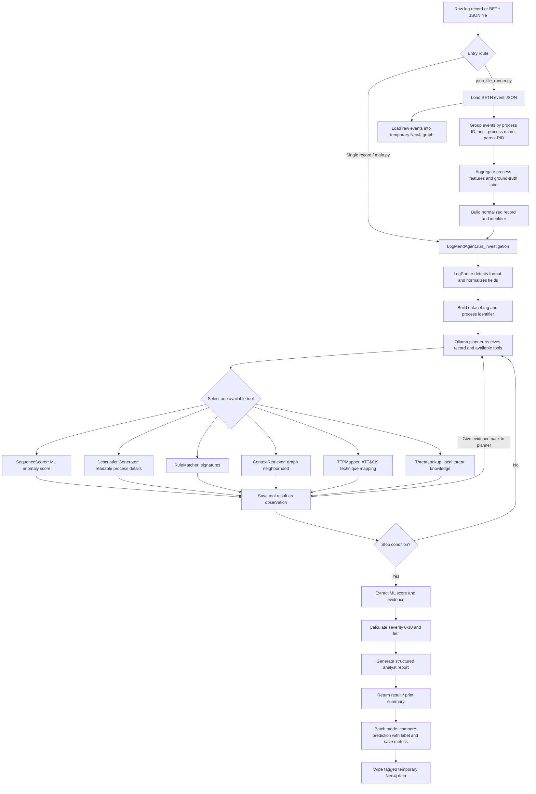

# LogMend 2.0: End-to-End Flow Guide

This guide explains how data moves through the `Logmend_2` project: from raw BETH or DARPA logs, through parsing and investigation tools, to the final severity and report. It follows the code in this folder and distinguishes the single-record route from BETH batch evaluation.

## 1. Big-picture flow diagram



**In one sentence:** the program identifies a process, gathers evidence with selected tools, gives that evidence to a local Ollama model to guide the next step, and then calculates a severity tier and writes a report.

## 2. Two ways data enters the agent

### A. Single-record route

`scripts/main.py` creates a `LogMendAgent` and calls `run_investigation(...)` with a single dictionary or JSON string. The agent parses that record, identifies the dataset, builds an identifier, and starts the investigation loop. The `scripts/main.py` example/benchmark path is for individual example records; it is not the BETH event-file grouping pipeline.

### B. BETH JSON batch route

`scripts/json_file_runner.py` is the route for BETH event files such as `data/cleaned/beth/test/part_1.json`. Its command-line interface accepts either `--file` or `--dir`, and optionally `--limit` to cap the number of unique processes investigated per file.

For each file, the runner:

1. Reads the raw JSON event list.
2. Loads those events into Neo4j as temporary graph data.
3. Groups events that belong to the same process.
4. Aggregates one feature bundle and one evaluation label per process.
5. Builds a process-shaped record with precomputed features and sends it to `LogMendAgent`.
6. Compares the returned tier with the process label and writes evaluation output.
7. Calls graph cleanup in a `finally` block, so cleanup is attempted even if investigation raises an error.

The process grouping key is `(processId, hostName, processName, parentProcessId)`. This means the unit investigated in batch mode is a **process group**, not an individual event line.

## 3. BETH batch ingestion: how events become process features

The raw BETH test records are nested. Typical data is stored in blocks such as `event`, `process`, `host`, `user`, and optional `file_path` and `socket` objects. The runner reads these fields to summarize all events in a process group.

| Feature | What it represents | How the BETH batch runner derives it |
|---|---|---|
| `is_root` | Whether the process ran as root | True if any grouped event has `user.is_root == true` |
| `event_count` | Number of events in the process group | Number of raw events in that group |
| `sus_ratio` | Fraction of events marked suspicious | Count of `event.sus == 1`, divided by event count |
| `evil_ratio` | Fraction of events marked evil | Count of `event.evil == 1`, divided by event count |
| `net_ratio` | Fraction of network events | Count of `event.is_network_op == true`, divided by event count |
| `c2_event_count` | Known command-and-control event count | Set to 0 by raw-file aggregation; the raw BETH events do not supply this value here |
| `file_write_count` | File writes and deletions | Count of `file_path.flags_category == "write"` or `event.is_delete_op == true` |
| `inject_count` | Process injection event count | Set to 0 by raw-file aggregation; this BETH path does not derive ptrace injection signals |
| `bias` | Constant model input | Added as `5.0` by `SequenceScorer`, not calculated from events |

The runner also calculates `has_sensitive_path` if a file pathname contains one of `/etc/shadow`, `/etc/passwd`, `.ssh/`, or `/proc/`. It chooses the first non-empty event `cmdLine` as the process command line.

For batch evaluation, the ground-truth process label is **malicious (`1`) if any event in the group has `event.evil == 1`**; otherwise it is benign (`0`). This label is used later for evaluation metrics. It is not itself the model prediction.

The runner creates a normalized record with fields such as `datasetTag`, `pid`, `hostName`, `processName`, `parentPid`, `cmdLine`, and `isRoot`. It places the feature bundle under `precomputed_features` and passes that record to the agent. `build_record_and_identifier()` also constructs an identifier, but the current `run_file()` path calls the agent with the record; `run_investigation()` parses it and carries `precomputed_features` into its own identifier. The scorer sees that key and takes its precomputed-feature path rather than requiring the process to be found in the permanent training graph.

## 4. Temporary Neo4j graph in BETH batch mode

Before investigating a file, `load_ephemeral_graph()` inserts its raw BETH events into Neo4j in batches of 1,000. It creates or merges graph objects including:

- `Process`, `Host`, and `User` nodes
- `RUNS_ON` and `RUNS_AS` relationships
- Parent-to-child `SPAWNED` relationships
- `Event` nodes connected to processes with `EMITS`
- `FileObject` nodes and `ACCESSED` relationships when a file path is present

Temporary objects are tagged with the `TestGraph` label or property. Before loading, the loader removes tagged leftovers from a previous interrupted run. After the file finishes, `wipe_ephemeral_graph()` removes relationships marked `TestGraph` and nodes labeled `TestGraph`.

The temporary loader uses its own local Neo4j URI and credentials in `scripts/json_file_runner.py`; the investigation tools use the dataset-specific settings managed by `logmend/database/neo4j_router.py`. Configure these connections so the runner and tools reach the intended Neo4j database. In the temporary loader, network/socket data is not turned into `CONNECTED_TO` network-flow nodes; the loader builds the process, event, and file context shown above.

## 5. Parsing and the common record

[`logmend/tools/log_parser.py`](../logmend/tools/log_parser.py) accepts either JSON text or an already-loaded Python dictionary. It recognizes:

1. **Nested BETH:** process/event data is in nested objects.
2. **Flat BETH:** process fields are at the top level.
3. **DARPA THEIA:** a record with a UUID.

The parser produces a common record structure so the investigation code can use consistent field names. Important fields include:

- Dataset: `datasetTag` (`beth` or `darpa`)
- Process identity: BETH `pid`, `hostName`, `processName`, and `parentPid`, or DARPA `uuid`
- Process details: `cmdLine`, `userId`, and `timestamp`
- Labels/signals: `sus`, `evil`, `isRoot`, and BETH event indicators
- Optional BETH file information: `filePath`, `fileFlagsCategory`, and `hasSensitivePath`

`run_investigation()` then builds an identifier. BETH tools generally receive `pid`, `host_name`, `process_name`, and `parent_pid`; DARPA tools receive `uuid`. Batch input also carries `precomputed_features` so `SequenceScorer` can score the aggregated process directly.

## 6. Tool setup and the TAO loop

When `LogMendAgent` starts, it creates the six tool objects, puts them in a registry, and creates an `OllamaRouter`. The registry connects each tool name to the method that should run when the planner selects it.

The loop is **Thought → Action → Observation**:

1. **Thought:** `scripts/main.py` sends a system prompt and the current conversation to the Ollama chat API. The prompt includes the record summary, the observations collected so far, and available tool descriptions. The planner is expected to return JSON with a hypothesis, `next_tool`, and malicious/benign confidence values.
2. **Action:** the agent checks that the selected tool exists and has not already been used, then invokes it with the process identifier, dataset tag, and prior observations.
3. **Observation:** the tool’s JSON result is saved with the tool name and planner thought. A shortened result is added to the conversation for Ollama’s next decision.
4. The loop repeats until a stop condition is met.

The initial prompt asks the planner to select `SequenceScorer` first. Each of the six tools can be used once. The code also sets a ten-tool hard limit (higher than the six-tool registry), confidence thresholds of `0.75` malicious and `0.85` benign, and up to three retries if the planner attempts to reuse a tool. With six unique tools, tool exhaustion normally ends the loop first if all tools are used.

### The six investigation tools

| Tool | What it receives or looks up | What it returns / adds |
|---|---|---|
| `SequenceScorer` | Dataset and process identity; for BETH batch mode, the precomputed feature bundle. Otherwise it queries Neo4j for features. | Anomaly score from 0 to 1, model-by-model scores, extracted features, and source (`precomputed` or `neo4j`). |
| `DescriptionGenerator` | Process identity, then a dataset-specific Neo4j query. | Readable process summary: command line, parent, host/user details, privileges, and DARPA network targets when available. |
| `RuleMatcher` | Process identity and graph-derived or available process data, with dataset-specific checks. | Matching signatures, C2 match information where applicable, and a severity hint. |
| `ContextRetriever` | Process identity and Neo4j graph. | Process neighborhood: parent/child context, files, network information, and C2 flag where supported by the dataset query. |
| `TTPMapper` | Process identity and behavioral description/context. | A candidate MITRE ATT&CK technique, tactic, and similarity information from its supported technique set. |
| `ThreatLookup` | Usually a technique produced by `TTPMapper`; the registry can also use its C2 fallback when a prior `RuleMatcher` observation indicates a C2 match. | A lookup result from the project’s local threat knowledge base. |

Tools return JSON text. If a tool raises an exception, the agent records an error-shaped result as an observation and continues through the loop. The planner sees summaries of the observations, not just the original log record, and uses those results to decide what to inspect next.

## 7. What SequenceScorer does with the data

The scorer loads the trained model artifacts from `artifacts/saved_models/`. Its expected feature vector has nine positions: root status, event count, suspicious ratio, evil ratio, a constant bias, network ratio, C2 count, file-write count, and injection count.

For BETH it scales the vector and combines three model scores:

- GraphCL: weight `0.40`
- Isolation Forest: weight `0.30`
- Deep SAD: weight `0.30`

For DARPA it combines:

- MAGIC: weight `0.40`
- FLASH: weight `0.35`
- ORTHRUS: weight `0.25`

The GNN/graph-aware model code can use a Neo4j process subgraph if one can be retrieved. For BETH batch data, the scorer first tries to get subgraph context from the temporary graph; if that fails, its precomputed path can fall back to scoring the process as a single node. Scaler/model errors or missing artifacts can prevent successful scoring; this is returned as an error observation rather than a valid anomaly score.

The neural architectures are in [`logmend/models/architectures.py`](../logmend/models/architectures.py). The BETH and DARPA training scripts extract training data from Neo4j and save weights/scalers into `artifacts/saved_models/` for runtime use.

## 8. Neo4j connections and tool data

[`logmend/database/neo4j_router.py`](../logmend/database/neo4j_router.py) lazily creates Neo4j drivers for `beth` or `darpa`, using the matching environment variables. Tools call its `query()` method, which opens a session, runs Cypher with parameters, and returns rows as dictionaries.

Neo4j is the graph/context store, not the Ollama planner. The planner receives tool results through the conversation; it does not directly issue Cypher. The BETH batch runner’s temporary graph is meant to provide investigation context for test events, and its tagging/cleanup logic is in `scripts/json_file_runner.py`.

## 9. Severity: turning evidence into BENIGN / SUSPICIOUS / MALICIOUS

After the loop finishes, `scripts/main.py` extracts the SequenceScorer anomaly score, features, and supporting context from the collected observations. It passes them to `logmend/utils/severity_calculator.py`.

The main formula is:

```text
likelihood = anomaly_score × 10
severity   = 0.60 × likelihood + 0.40 × impact
```

Impact uses dataset-specific evidence. BETH weighs mapped technique impact, rule/path/root signals, and event volume. DARPA weighs kill-chain stage, C2 activity, injection events, root privilege, rule matches, and file writes. The code also dampens impact for a list of common benign system processes when no rule or C2 evidence is present.

The final tier is determined from the 0–10 score:

| Severity | Tier |
|---:|---|
| `< 3.5` | `BENIGN` |
| `3.5` to `< 6.5` | `SUSPICIOUS` |
| `>= 6.5` | `MALICIOUS` |

The tier is a deterministic result of the severity calculation. The planner’s confidence values control loop stopping; they are not directly substituted for this severity score.

## 10. Final report and batch evaluation output

When tool collection ends, `scripts/main.py` builds a structured report from the record, observations, and severity metrics. It returns a dictionary that includes the dataset, identifier, anomaly score, severity metrics, tools used, tool count, report, and reasoning trace. It also prints a summary. The agent reports findings and recommended analyst action; it does not automatically isolate a host, kill a process, or remediate a threat.

In BETH batch mode, `scripts/json_file_runner.py` maps the tier to a binary prediction:

- `BENIGN` → predicted label `0`
- `SUSPICIOUS` or `MALICIOUS` → predicted label `1`

It compares that prediction with the group’s ground-truth label, updates TP/TN/FP/FN counts, and calculates accuracy, precision, recall, and F1. Each input file produces a timestamped `LogMend_BETH_...txt` report in the current working directory. In directory mode, the command-line code runs files in turn and applies the same temporary-graph cleanup around each file.

## 11. Training and other project files

| Path | Role in the flow |
|---|---|
| `scripts/main.py` | Agent setup, tool registry, Ollama-guided TAO loop, severity handoff, report generation, and example/benchmark route. |
| `scripts/json_file_runner.py` | BETH event-file ingestion, process grouping, feature aggregation, temporary graph loading, batch evaluation, and text output. |
| `logmend/tools/log_parser.py` | Converts supported raw record formats to a common record. |
| `logmend/tools/sequence_scorer.py` | Loads saved ML artifacts, prepares/scales features, runs ensemble scoring, and formats anomaly-score output. |
| `logmend/tools/description_generator.py` | Produces a readable process description, using Neo4j. |
| `logmend/tools/rule_matcher.py` | Matches process behavior against configured signatures. |
| `logmend/tools/context_retriever.py` | Retrieves graph context from Neo4j. |
| `logmend/tools/ttp_mapper.py` | Maps behavior to supported ATT&CK techniques. |
| `logmend/tools/threat_lookup.py` | Looks up techniques/indicators in the local threat knowledge base. |
| `logmend/agent/ollama_router.py` | Sends planner/reporter chat requests to the configured local Ollama model. |
| `logmend/database/neo4j_router.py` | Provides dataset-specific Neo4j connections and parameterized query execution. |
| `logmend/utils/severity_calculator.py` | Combines anomaly score and impact into severity and tier. |
| `logmend/models/architectures.py` | Neural model architectures used by the scoring ensembles. |
| `scripts/train_beth_models.py` | Extracts BETH graph data, trains BETH models/scaler, and saves artifacts. |
| `scripts/train_darpa_models.py` | Extracts DARPA graph data, trains DARPA models/scaler, and saves artifacts. |
| `artifacts/saved_models/` | Saved weights and scalers loaded at runtime by the scorer. |
| `data/cleaned/beth/test/` | Example BETH nested JSON event files for batch evaluation. |
| `scripts/evaluate_metrics.py` | Evaluation/metric utilities. |
| `tests/test_tools.py`, `tests/test_connections.py`, `tests/test_batch2.py` | Project test or diagnostic scripts. |
| `references/papers/` | Reference PDFs; these explain research background but are not runtime pipeline components. |

## 12. Runtime requirements and configuration

The flow depends on services and artifacts being available:

- **Ollama** must be running, with the model named by `LOGRESP_MODEL` available. `OLLAMA_URL` configures the Ollama server URL.
- **Neo4j** must be reachable with BETH and/or DARPA credentials configured. The graph tools need the appropriate dataset graph; BETH batch mode also uses the runner’s temporary graph loader.
- **Model artifacts** for the dataset must exist under `artifacts/saved_models/` and be compatible with the installed PyTorch/PyTorch Geometric environment.
- Python dependencies include the packages described in `README.md`; the README notes there is no pinned dependency manifest in this project.

## 13. Code-reading notes and practical limitations

- The implementation currently uses **Ollama** through `logmend/agent/ollama_router.py`. Some comments near the top of `scripts/main.py` are stale and mention Claude/Anthropic; follow the actual imports and calls when tracing runtime behavior.
- The `scripts/json_file_runner.py` docstring and its live implementation have evolved. The current `run_file()` builds a normalized record with `precomputed_features`, then passes that record through `run_investigation()`. The helper also returns an identifier, though this call path does not pass that identifier. That is why the parser’s output and feature-preservation code matter to the batch scoring route.
- A tool can return an error if a process is absent from Neo4j, a query fails, or a model artifact is missing. The agent stores tool errors as observations, but a valid final anomaly score still depends on a successful `SequenceScorer` run.
- BETH batch truth labels come from the dataset’s `evil` annotation, while the model prediction is produced from features and investigation evidence. The truth label is for evaluation; it is not a command to the agent to classify that process as malicious.
- This project is a research prototype. The numbers produced by its evaluation scripts describe the run and dataset supplied; they should not be confused with metrics reported by a paper unless the experiment, data, and methodology match.

## 14. Short version to remember

```text
Raw events
  → normalize or group by process
  → identify dataset and process
  → score and collect selected evidence
  → Ollama chooses the next useful tool
  → stop when confident / done / out of tools
  → calculate severity and tier
  → write report
  → in batch mode, compare against labels and clean temporary graph data
```
